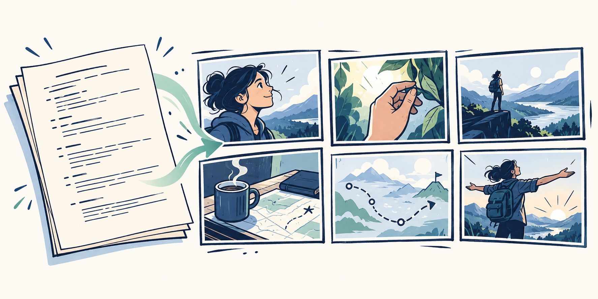
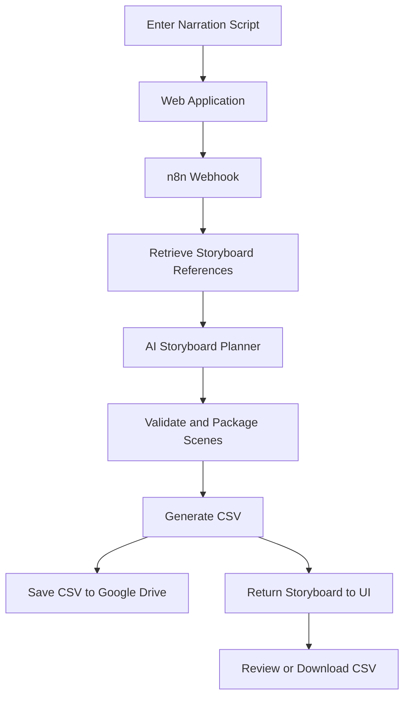

# Project Storyboard



**Turn a complete narration script into a structured, animator-ready storyboard.**

Project Storyboard is a web application that uses AI to break down narration scripts into individual scenes. Each scene includes its voiceover, visual action, background, characters and props, on-screen text, and transitions or motion instructions.

The goal is to make storyboard creation faster and more consistent while giving animators a structured CSV they can review and use in their production workflow.

**This project generates storyboards, not images or videos.**

## Quick Links

| Resource | Link |
|---|---|
| Live Application | [Open Project Storyboard](https://project-storyboard.vercel.app/) |
| Saved Storyboards | [Open Google Drive Folder](https://drive.google.com/drive/folders/1hiwy8D0GWx61tweE636SqqkktvWOABgY) |
| Example Output | [View Test Storyboard CSV](https://drive.google.com/file/d/1dDwl-EMU5Cvg3v35gmsaN4IWF8HjD5-8/view) |
| GitHub Repository | [rayvin04/project-storyboard](https://github.com/rayvin04/project-storyboard) |
| Related Project | [Script to Storyboard](https://github.com/rayvin04/script-to-storyboard) |

## What It Does

Project Storyboard automates the process of turning a script into a scene-by-scene visual plan.

### Key Features

- **Script-to-storyboard generation:** Submit a complete narration script and generate a structured scene plan.
- **Style-guided planning:** Use connected storyboard examples and the Evprof Storyboard Creation Guide to guide the AI's scene descriptions and formatting.
- **Structured CSV output:** Organize the result into eight consistent columns.
- **Storyboard preview:** Review the generated scenes in a table inside the application.
- **CSV download:** Download the storyboard directly to your computer.
- **Google Drive storage:** Save valid storyboard CSV files for future access.
- **Saved storyboard access:** Open the Google Drive folder directly from the interface.
- **Consistent formatting:** Use `None` when a scene has no on-screen text and `Hard cut.` when no special transition or movement is needed.
- **Responsive interface:** Review storyboards through a focused web interface with light and dark themes.

## How It Works

The application connects a web interface to an n8n workflow that handles storyboard generation and packaging.



The workflow follows these stages:

1. **Script submission:** The user enters the complete narration in the web application.
2. **Reference retrieval:** The workflow consults its connected reference material and storyboard creation guide.
3. **Storyboard planning:** The AI organizes the narration into scenes and creates the corresponding visual descriptions.
4. **Validation and packaging:** The workflow processes the generated scenes and prepares the eight-column CSV.
5. **Persistent storage:** The workflow attempts to save the CSV to the designated Google Drive folder.
6. **Frontend response:** The application displays the storyboard and allows the user to download the CSV or access saved outputs.

Google Drive upload status is handled separately from storyboard generation, so a valid storyboard can remain available even if saving the file fails.

## Storyboard CSV Format

Every storyboard uses the following eight columns in this order.

| Column | Purpose |
|---|---|
| Scene | Sequential scene number. |
| Timestamp | Scene timing or an estimated time range. |
| Voiceover | The narration assigned to the scene. |
| What's happening | A short description of the visible action. |
| Background | The setting and environment for the scene. |
| Hand-drawn characters & props | The characters, objects, and diagrams to be drawn. |
| On-screen text | The text that should appear visibly on screen. |
| Transitions/Motion | Short instructions for scene transitions, camera movement, or animation. |

### Formatting Rules

**On-screen text**

When a scene does not need visible text, the field should contain `None` rather than an empty value. When text is useful, the field contains the actual label, title, or callout.

**Transitions/Motion**

When no special movement is needed, the default is `Hard cut.`. When a scene requires a particular effect, its specific instruction is retained.

These conventions make the CSV more consistent and easier for animators to review.

## How to Use the Application

1. Open the [Project Storyboard application](https://project-storyboard.vercel.app/).
2. Paste your complete narration script into the input field.
3. Optionally load the provided sample script to test the application.
4. Select **Create storyboard**.
5. Wait for the workflow to finish processing the script.
6. Review the resulting scenes in the storyboard table.
7. Select **Download CSV** to save a local copy.
8. Select **View saved storyboards** to open the Google Drive folder and access previously saved outputs.

Review the generated storyboard before handing it to animators. AI-generated scene descriptions may still need editorial adjustments.

## Google Drive Storage

Generated storyboard CSVs are stored in the designated Google Drive folder:

[**Open Saved Storyboards**](https://drive.google.com/drive/folders/1hiwy8D0GWx61tweE636SqqkktvWOABgY)

The workflow uses the storyboard title along with a timestamp and job identifier in the filename to help distinguish separate runs.

Each successful save creates a separate file so that earlier storyboards can be retained.

If Google Drive saving fails, the workflow reports the save status rather than claiming that the file was backed up. The storyboard may still be available in the application for local download.

## Technology and Architecture

| Technology | Role |
|---|---|
| HTML | Defines the frontend structure. |
| CSS | Controls layout, styling, themes, and responsive behavior. |
| JavaScript | Handles user input, webhook communication, CSV processing, and table rendering. |
| Vercel | Hosts the web application. |
| n8n | Orchestrates the storyboard-generation workflow. |
| AI language model | Converts the narration into structured scene descriptions. |
| Google Sheets | Supplies connected storyboard examples and reference data, where configured. |
| Google Docs | Stores the Evprof Storyboard Creation Guide used to guide generation. |
| Google Drive | Stores generated storyboard CSV files. |

The exact AI model and provider depend on the active workflow configuration.

## Scope and Limitations

Project Storyboard focuses specifically on storyboard planning and CSV delivery.

It does:

- Convert narration scripts into structured scene plans.
- Produce descriptions intended for animators.
- Provide an in-browser preview and downloadable CSV.
- Save storyboard outputs to Google Drive when the upload succeeds.

It does not:

- Generate background images.
- Automatically draw the characters, props, or diagrams.
- Generate finished animations or videos.
- Automatically publish videos to YouTube.
- Send editing-team notifications.

The storyboard is a production-planning document, not a finished visual product. Animators remain responsible for interpreting the scene descriptions and creating the actual visuals.

The output also depends on the submitted script, connected references, model behavior, and workflow configuration. Review the storyboard for accuracy and completeness before using it in production.

## Local Development

The frontend is a static web application.

To serve the files locally, open a terminal in the project directory and run:

```bash
python -m http.server 4173
```

Then open:

```text
http://localhost:4173
```

The local interface still depends on the configured n8n webhook for storyboard generation. A working local frontend does not guarantee that the remote workflow or Google Drive integration is available.

## Repository Structure

The main project files include:

```text
project-storyboard/
├── index.html
├── styles.css
├── app.js
├── favicon.svg
├── README.md
└── docs/
    ├── images/
    │   └── project-storyboard-cover.png
    ├── examples/
    └── Project-Storyboard-Quick-Guide.docx
```

The `docs/` directory contains supporting documentation and examples. The cover image and Word guide should be present in the repository for the corresponding links to work.

## Related Project

Project Storyboard is related to [Script to Storyboard](https://github.com/rayvin04/script-to-storyboard), another project focused on the script-to-storyboard workflow.

The two projects should be documented separately because their implemented capabilities differ. Project Storyboard does not include image generation.

## Author

**Rayvin Gianan**

AI Automation Specialist

- Portfolio: [rayvingianan.r4yv.tech](https://rayvingianan.r4yv.tech)
- GitHub: [rayvin04](https://github.com/rayvin04)

---

*Project Storyboard helps turn narration into a clear, structured visual plan that animators can review and build upon.*

